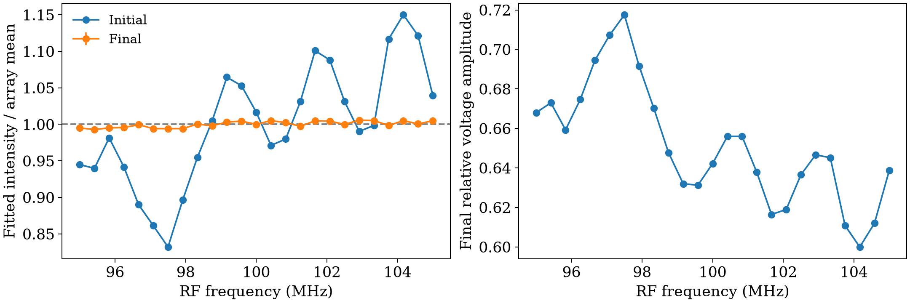

# AOD feedback report

Camera 33834; exposure 150 µs; gain index 0.
Mapping: RF tone j maps to zero-based camera spot TONE_TO_SPOT[j], saved in final_settings.json.
Intensities are fitted peak amplitudes of the transversely averaged strip, not integrated optical powers.

| Metric | Initial (3 frames) | Verified final (10 frames) |
|---|---:|---:|
| Mean fitted intensity (counts) | 60.3771 | 59.8360 |
| RMS nonuniformity | 8.090% | 0.422% |
| Maximum deviation from mean | 16.797% | 0.708% |
| Predicted RF power (dBm) | -5.783 | -5.756 |

Verified target (1.00% maximum deviation) reached: **True**.
A completed run does not imply convergence. Uniformity can drift after verification.
Final spot means span 59.4125–60.1778 counts.
RF power is calculated from DAC samples and the output range into 50 ohms, not measured with a power meter.

Full per-tone values: initial_final_per_tone.csv. Settings/phases: final_settings.json.
Exact final samples: final_waveform.npz. Raw images and metadata are stored alongside this report.
RF left running at completion: True. Live monitor stopped; camera open/disarmed.
AWG.stop() uses the existing HOLDLAST mode and is not a guaranteed zero-voltage interlock.
